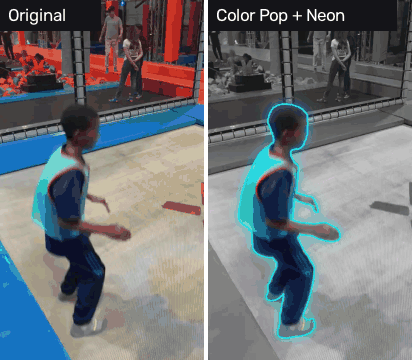
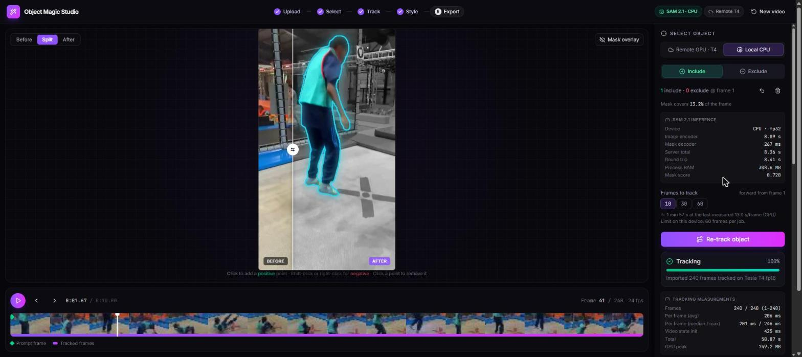
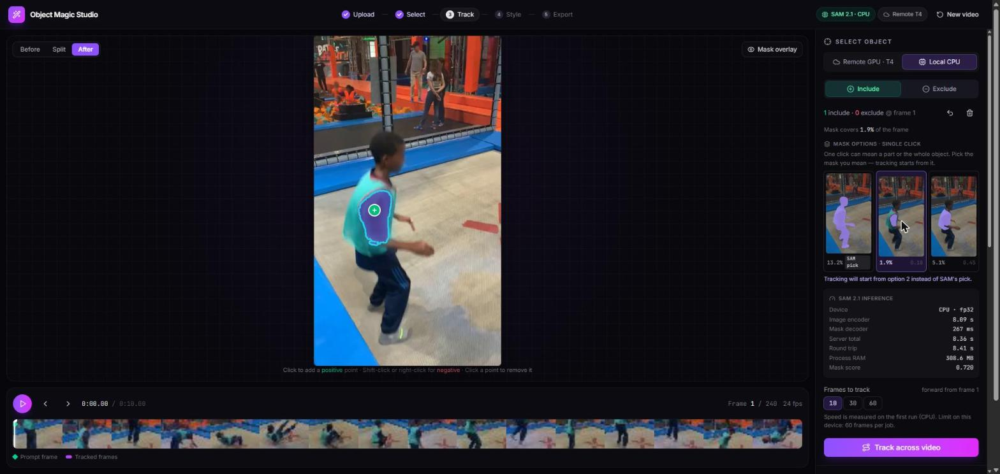
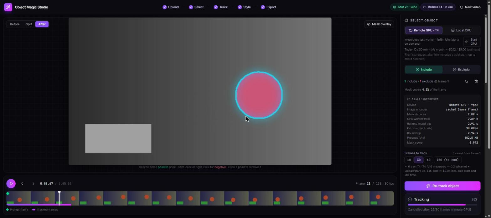
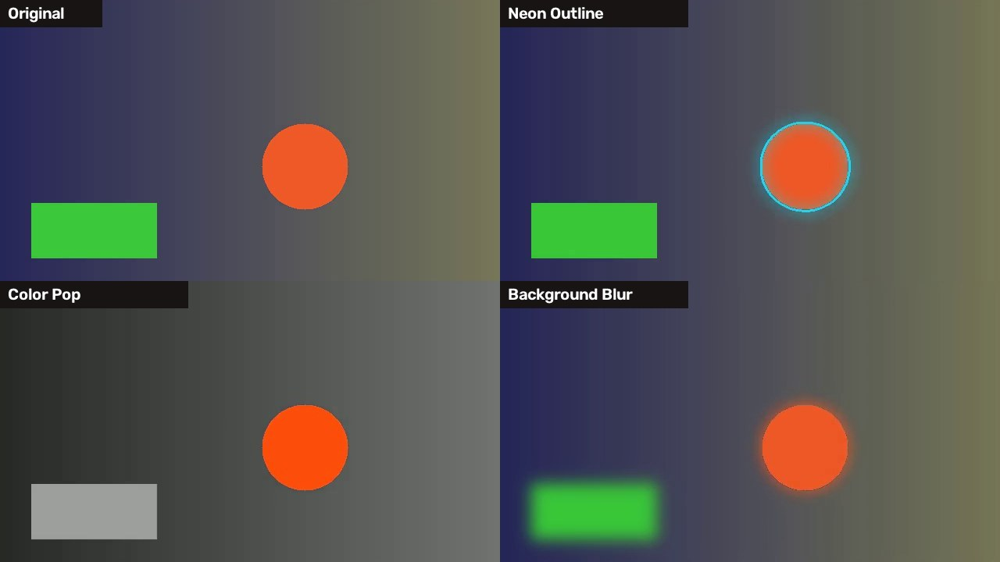
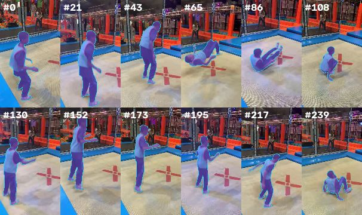
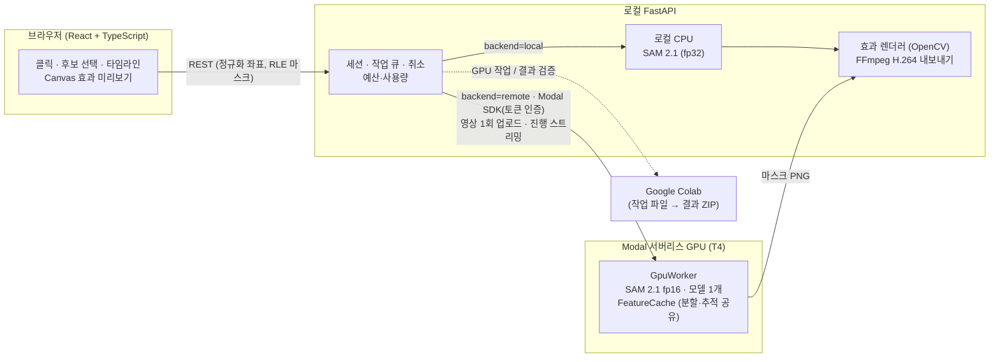
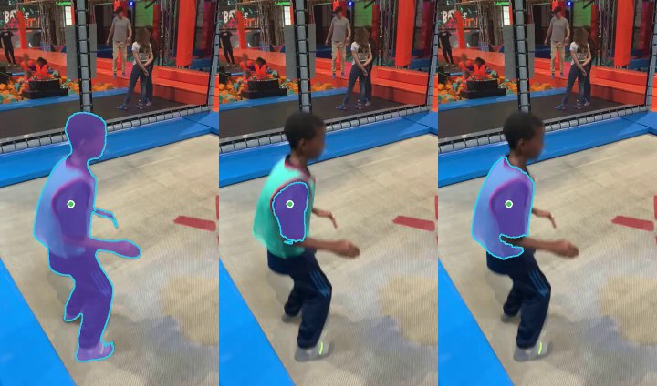
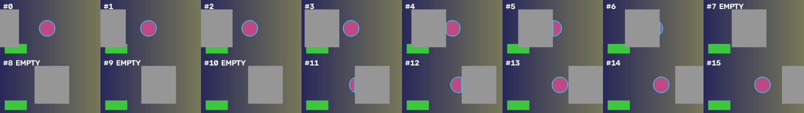
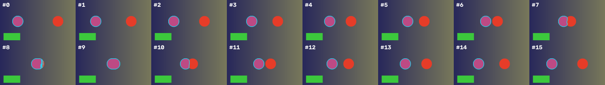

# Object Magic Studio

짧은 영상에서 **객체를 클릭하면 Meta SAM 2.1이 분할하고 영상 전체에서 추적**합니다. 추적한 객체에 **Neon Outline / Color Pop / Background Blur** 효과를 입혀 MP4로 내보내는 풀스택 웹 애플리케이션입니다.

<p align="center">
  
</p>
<p align="center"><sub>원본(왼쪽) | 결과(오른쪽). 아이를 한 번 클릭 → Tesla T4에서 SAM 2.1로 추적 → 같은 마스크로 Color Pop + Neon 적용. SA-V 데이터셋 영상(CC BY 4.0), 5초 구간을 12fps로 표시</sub></p>

- **실제 모델 추론**: 공식 SAM 2.1 Hiera Tiny와 공식 API(`SAM2ImagePredictor`, `SAM2VideoPredictor`)를 씁니다. 추적을 흉내 내는 대체 로직은 없습니다.
- **세 가지 연산 위치**: 로컬 CPU, **원격 서버리스 GPU(Modal T4)**, Colab GPU 작업 파일 중에서 고를 수 있습니다.
- **측정 기반**: 모든 속도와 정확도 수치는 실제로 측정한 값입니다. 정답 데이터(SA-V)로 정확도를 평가했고, CPU 결과는 "실시간"이라고 표현하지 않습니다.


<sub>SA-V 데이터셋 영상(CC BY 4.0) · Tesla T4에서 추적한 240프레임 결과에 Color Pop + Neon Outline을 적용하고, 왼쪽은 원본, 오른쪽은 결과로 나눠 보여 주는 화면</sub>

## 주요 기능

| 기능 | 설명 |
|---|---|
| **클릭 분할** | 포함/제외 클릭을 여러 번 할 수 있습니다. 같은 프레임의 추가 클릭은 이미지 임베딩을 재사용해 디코더만 실행합니다. |
| **마스크 후보 선택** | 한 번만 클릭하면 SAM이 만든 후보 3개(부분 / 전체 / 더 넓은 영역)를 나란히 보여 줍니다. 고른 마스크가 **그대로 추적의 시작점**이 됩니다(`add_new_mask`). |
| **영상 추적** | 클릭한 프레임부터 정방향으로 최대 300프레임(GPU)을 추적합니다. 진행률과 ETA를 보여 주고, 취소하면 이미 추적한 프레임을 유지합니다. 객체가 사라지거나 면적이 급변한 프레임은 타임라인에 표시됩니다. |
| **효과 + 미리보기** | Neon Outline, Color Pop, Background Blur의 강도를 조절하고 Before / Split / After로 비교합니다. 미리보기(Canvas)와 결과물(OpenCV)은 같은 공식을 씁니다. |
| **MP4 내보내기** | 추적 마스크를 재사용합니다(재추론 없음). FFmpeg H.264로 내보내며, **원본의 정확한 FPS(예: 30000/1001)와 오디오를 유지**하고 ffprobe로 다시 검증합니다. |
| **원격 GPU 자동 연결** | Modal 서버리스 T4를 씁니다. 분할과 추적이 **같은 모델 인스턴스와 프레임 임베딩을 공유**하고, 사용하지 않을 때는 0원입니다. 예산 한도, 취소, 진행률 스트리밍을 지원합니다. |
| **오프라인 GPU 작업** | Colab용 작업 파일을 만들고, 결과 ZIP을 가져올 때 해시·프레임·마스크를 검증합니다. |

## 데모

| 마스크 후보 선택 (한 번 클릭) | 원격 GPU 선택과 비용 표시 |
|---|---|
|  |  |
| 조끼를 한 번 클릭 → 후보 3개 중 조끼 영역(2번)을 선택 | Remote GPU / Local CPU 전환, 사용량·추정 비용, 원격 추적 진행률 |

| 효과 3종 (합성 테스트 영상, 출력 MP4 프레임) | SA-V 정답 영상 추적 (T4 fp16, 240프레임 중 12장) |
|---|---|
|  |  |

## 시스템 구조



- **같은 추론 코드**: 로컬, Modal, Colab이 모두 [`backend/app/inference`](backend/app/inference)(Sam2Engine, Sam2ImageService, VideoTracker)를 그대로 실행합니다. 장치별 차이는 `CpuRuntime`과 `CudaRuntime`(정밀도, 오프로딩, OOM 처리)에만 있습니다.
- **임베딩 공유**: 원격 GPU에서는 첫 클릭 때 계산한 프레임 특징을 캐시해 두고, 추가 클릭과 추적 시작에 다시 씁니다. 그래서 추적할 때 인코더 호출이 1회 줄어들며, 재사용하지 않은 경우와 결과가 같습니다(IoU 1.000).
- **결과 형식 통일**: 어떤 방식으로 추적하든 원본 해상도 마스크 PNG를 같은 위치에 저장합니다. 그래서 미리보기와 내보내기 코드는 하나뿐입니다.
- **메모리**: 영상 프레임을 필요할 때만 읽는 지연 로더 덕분에 CPU 메모리 사용량이 프레임 수와 무관하게 일정합니다. 브라우저는 마스크를 RLE로 보관하고 필요할 때만 디코딩합니다.

**기술 스택**: React 18 · TypeScript · Tailwind CSS v4 · Vite 6 · Zustand · Vitest / Python 3.13 · FastAPI · PyTorch · OpenCV · FFmpeg / SAM 2.1 Hiera Tiny ([facebookresearch/sam2](https://github.com/facebookresearch/sam2) `2b90b9f5`) / Modal · Google Colab

## GPU 벤치마크

같은 합성 테스트 영상(640×360, 30fps)과 같은 체크포인트(SHA-256 확인)로 측정했습니다. 원본 기록은 [docs/phase5a](docs/phase5a/), [docs/phase5b2](docs/phase5b2/README.md)에 있습니다.

| 항목 | 노트북 CPU (fp32) | Colab T4 fp32 | Colab T4 fp16 | **Modal T4 fp16** (웹앱 원격) |
|---|---|---|---|---|
| 이미지 인코더 (새 프레임) | 8,226ms | 160ms | 125ms | 121ms |
| 클릭 왕복 (같은 프레임 추가 클릭) | 0.3~0.6초 | — | — | 약 1초 (네트워크 포함) |
| 추적, 프레임당 | 16,820ms | 411ms | 181ms | **165ms** |
| **300프레임(10초) 추적** | 약 84분 (추정) | 132초 | 56초 | **67초** (업로드·스트리밍 포함) |
| 최대 GPU 메모리 | — | 952MB | 804MB | 889MB |
| 정답 대비 IoU (300프레임 평균) | 0.989 (60프레임) | 0.988 | 0.986 | 0.984 |

- **fp16은 fp32보다 2.3~2.5배 빠르고**, 정확도 차이는 무시할 만합니다. SA-V 실제 영상에서 J 차이는 최대 0.0006입니다.
- GPU fp32는 CPU와 **같은 마스크**를 만듭니다(IoU 1.000).
- **Modal 운영 수치** (실제 720p 영상):
  - 콜드 스타트 **19초**, 첫 클릭 34초(콜드 스타트와 영상 전송 포함), 이후 클릭 1.1초
  - 289프레임 추적 115초
  - 10초 영상 하나의 추정 비용 **약 $0.044**(T4 + CPU + 메모리, 대기 120초 포함)
- 추적 속도는 실시간이 아닙니다(T4 fp16 약 5~6fps).

## 실제 영상 결과

SA-V 데이터셋(정답 마스크 포함, CC BY 4.0) 영상 1개와 공개 샘플 영상 7개(사람·동물·사물)로 검증했습니다. 자세한 내용은 [docs/realworld](docs/realworld/README.md)에 있습니다.

**정답 대비 정확도 (SA-V, 240프레임 중 정답이 있는 60프레임, Colab/Modal T4 fp16)**

| 대상 | 프롬프트 | J&F |
|---|---|---|
| 객체 0 / 1(아이) / 2(가려짐 있음) | 한 번 클릭 | **0.936 / 0.965 / 0.919** |
| 객체 4 (조끼) | 한 번 클릭, SAM 기본 후보(아이 전신을 고름) | ❌ 0.098 |
| 객체 4 (조끼) | 한 번 클릭 + **후보 선택(조끼)** | ✅ **0.946** |
| 객체 4 (조끼) | 클릭 3번 (포함 1 + 제외 2) | 0.954 |


<sub>한 번 클릭(초록 점)의 후보 3개. SAM의 기본값은 왼쪽(아이 전신)이지만, 정답 영역은 가운데 후보(IoU 0.83)입니다. 이 후보를 고르면 추적 정확도가 0.098에서 0.946으로 올라갑니다.</sub>

**정성 평가 (공개 샘플 영상 12개 대상)**
- ✅ 화면 밖으로 나갔다 들어오는 개, 손에 가려졌다 나타나는 블록: 자동으로 다시 잡습니다.
- ✅ 똑같은 컵을 6번 넘게 섞어도 다른 컵으로 바뀌지 않았고, 겹친 두 아이와 빠른 축구공도 끝까지 따라갔습니다.
- ⚠️ 컵 아래 숨은 공: 숨어 있는 동안 반지·손끝에 작은 오검출이 생깁니다.
- ⚠️ 반사되는 주전자: 얇은 주둥이가 일부 프레임에서 빠지고, 물줄기가 마스크에 포함됩니다.

**내보내기 검증**: 모든 프레임을 같은 마스크·같은 효과로 만든 무손실 기준 렌더와 비교했습니다. PSNR은 최저 34.8dB로, 차이는 압축 손실뿐입니다. FPS(30000/1001)와 오디오가 유지되고 프레임 수가 추적 구간과 같습니다. 검증 중 찾은 "오디오가 있는 영상의 마지막 프레임 누락" 버그는 수정했고 회귀 테스트를 추가했습니다.

**합성 장면 (정답을 정확히 아는 장면)**: 가려짐에서 복구는 ✅, 똑같은 물체 두 개가 교차하면 정체성이 뒤바뀌는 문제는 ❌입니다.

| 가려짐 → 자동 복구 | 똑같은 원 교차 → 다른 원을 따라감 |
|---|---|
|  |  |

## 설치 및 실행

요구 사항: Node.js 20+, Python 3.10+(개발 환경 3.13), Git. 아래 명령은 Windows PowerShell 기준입니다.

```powershell
# 1) 프론트엔드
cd frontend
npm install
npm run dev                       # http://localhost:5173

# 2) 백엔드 (다른 터미널)
cd backend
python -m venv .venv-sam2; .venv-sam2\Scripts\activate
pip install torch torchvision --index-url https://download.pytorch.org/whl/cpu   # GPU 가 있으면 CUDA 빌드
pip install -r requirements-sam2.txt
git clone https://github.com/facebookresearch/sam2.git third_party/sam2
git -C third_party/sam2 checkout 2b90b9f5ceec907a1c18123530e92e794ad901a4
$env:SAM2_BUILD_CUDA="0"; pip install -e third_party/sam2
curl.exe -L -o checkpoints/sam2.1_hiera_tiny.pt https://dl.fbaipublicfiles.com/segment_anything_2/092824/sam2.1_hiera_tiny.pt
python scripts/setup_ffmpeg.py    # FFmpeg 공식 안내 배포본을 SHA-256 검증 후 프로젝트 안에 설치 (PATH 변경 없음)
uvicorn app.main:app --port 8000  # 모델 로딩 약 30초, 화면 배지로 상태 확인
```

**원격 GPU (선택, Modal 계정 필요, 요금 발생)**
```powershell
cd backend
.venv-sam2\Scripts\modal token new                 # 브라우저 로그인
.venv-sam2\Scripts\modal deploy remote_gpu/modal_app.py
$env:OMS_REMOTE="modal"; uvicorn app.main:app --port 8000
python scripts/remote_smoke.py --provider modal --frames 300   # 연결·정확도·속도 점검 (약 $0.04)
```
`OMS_REMOTE`를 지정하지 않으면 로컬 CPU만 씁니다. 예산 한도(`OMS_REMOTE_DAILY_GPU_SECONDS`, `OMS_REMOTE_MONTHLY_USD`)와 그 밖의 설정은 [docs/phase5b2](docs/phase5b2/README.md)에 정리했습니다. 모델 없이 UI만 보려면 `http://localhost:5173/?mode=mock`으로 엽니다.

## 사용 방법

1. MP4를 끌어다 놓습니다(H.264, 10초 이하, 1920×1080 이하, 100MB 이하).
2. 오른쪽 **Select object**에서 연산 위치(Remote GPU / Local CPU)를 고르고, 객체를 클릭합니다.
   - 클릭은 포함, Shift+클릭이나 우클릭은 제외, 점을 누르면 삭제, `Ctrl+Z`는 되돌리기입니다.
   - **한 번만 클릭했다면 Mask options에서 원하는 후보를 고릅니다.** 부분을 원하는지 전체를 원하는지에 따라 다릅니다.
3. 추적 프레임 수를 고르고 **Track across video**를 누릅니다. 예상 시간과 원격일 때의 추정 비용이 표시됩니다.
4. 효과를 켜고 Before / Split / After로 비교한 뒤 **Export MP4**로 내보냅니다.

## 테스트

| 구분 | 개수 | 내용 |
|---|---|---|
| 프론트엔드 (Vitest) | 51 | API 클라이언트(오류 매핑, 타임아웃, 마스크 후보, 원격), RLE, 좌표, 검증, 효과 파라미터, 비용 계산 |
| 백엔드 빠른 테스트 (pytest) | 131 | API, 작업 큐와 취소, 효과 렌더러, **MP4 내보내기(실제 FFmpeg)**, GPU 결과 검증(잘못된 파일 18종 거부), 원격 GPU(가짜 워커 + pickle 왕복, 예산, 취소), 마스크 후보 → 추적 반영. **모델·GPU·Modal 계정 없이 실행**됩니다. |
| 백엔드 실제 모델 (`-m real_model`, CPU) | 12 | 실제 SAM 2.1 분할·추적, 합성 장면, Colab 작업 파이프라인, 원격 워커 임베딩 재사용, **선택한 후보로 추적 시작(IoU 0.998)** |

```powershell
cd frontend; npm test; npm run typecheck
cd backend; .venv-sam2\Scripts\python -m pytest -m "not real_model"
.venv-sam2\Scripts\python -m pytest -m real_model -s     # CPU 에서 약 20분
```
실제 GPU 비용이 드는 검증은 자동 테스트에 넣지 않고 [`scripts/remote_smoke.py`](backend/scripts/remote_smoke.py)로 따로 실행합니다.

## 알려진 한계

- **추적은 정방향만, 객체는 하나만** 지원합니다. 클릭한 프레임 이전 구간이나 여러 객체를 동시에 처리하지 못합니다.
- **영상 길이 10초 제한**이 있습니다. 실제 샘플 8개 중 2개가 초과로 거부됐고, 구간 선택(자르기) 기능은 없습니다.
- **비슷한 물체가 완전히 겹치며 교차하면** 다른 물체를 따라갈 수 있습니다(합성 장면에서 재현). 가려진 동안 엉뚱한 곳에 작은 오검출이 생길 수 있습니다. 다른 프레임에서 보정 클릭을 추가하는 기능은 아직 없습니다.
- **마스크 후보는 한 번 클릭일 때만** 보여 줍니다. 점을 더 찍으면 SAM의 여러 점 분할로 바뀝니다. Colab 작업 파일에는 클릭 점만 담기므로, 기본이 아닌 후보를 고르면 Colab 작업 생성을 거부합니다(로컬 CPU와 원격 GPU는 지원).
- **로컬 CPU는 느립니다.** 프레임당 11~25초이며, 작업당 60프레임으로 제한했습니다. 개발 PC의 GPU(MX150)는 드라이버가 오래돼 쓰지 못했습니다.
- **원격 GPU의 지연**: 콜드 스타트가 약 19초이고, 결과 마스크를 마지막에 한꺼번에 받아 289프레임 기준 약 19초가 더 걸립니다. 원격을 고르면 영상이 Modal(미국 클라우드)로 전송됩니다.
- **업로드 진행률이 표시되지 않습니다**(720p 업로드 6~17초). 세 효과를 함께 켜면 미리보기가 13fps로 끊깁니다(결과물은 정상).
- 모델이 하나라서 추적 중의 분할 요청은 대기 없이 `busy`(409)로 실패합니다. 마스크 경계는 이진이며 페더링이 없습니다.
- 로컬 서버는 개인 PC용(127.0.0.1)입니다. 네트워크에 공개하려면 API 인증을 따로 추가해야 합니다.

## 프로젝트 구조

```
frontend/src/        api(Live/Mock 클라이언트) · components · lib(RLE·좌표·효과·렌더러) · store(Zustand)
backend/app/         main.py(API) · sessions · jobs · effects · exporter · gpu_jobs
  inference/         engine · runtime(CPU/CUDA 정책) · frames(지연 로더) · features(임베딩 공유) · sam2_image · sam2_video
  remote/            worker(GPU 컨테이너) · transport(Modal / InProcess) · service · usage(예산)
backend/remote_gpu/  modal_app.py (Modal 배포 정의)
backend/scripts/     벤치마크 · Colab 번들 · 실제 영상 평가 · 원격 점검
backend/tests/       pytest (빠른 테스트 + real_model)
colab/               Colab 노트북 (벤치마크, 추적, 실제 영상 일괄 실행)
docs/                단계별 기록과 측정 결과 (DEVELOPMENT_LOG.md, realworld/, phase5b2/ ...)
```

## 문서

- [개발 기록 (Phase 1~5B-2)](docs/DEVELOPMENT_LOG.md): 단계별 구현 방식, 측정, 테스트, 문제 해결 기록
- [실제 영상 검증](docs/realworld/README.md): 테스트 계획, SA-V 정답 평가, 문제점과 개선 우선순위
- [원격 GPU (Modal)](docs/phase5b2/README.md): 구조, 보안·비용 제어, 실측, 배포 절차

## 출처와 라이선스

- **이 저장소에서 직접 작성한 코드와 문서**: [MIT License](LICENSE) (제3자 구성 요소는 [THIRD_PARTY_NOTICES.md](THIRD_PARTY_NOTICES.md))
- **SAM 2 / SAM 2.1** 코드와 체크포인트: Meta, [Apache 2.0](https://github.com/facebookresearch/sam2/blob/main/LICENSE). 이 저장소에는 포함하지 않으며 설치 과정에서 받습니다.
- **SA-V 데이터셋** 영상 `sav_000001`과 그 정답 마스크: Meta, [CC BY 4.0](https://creativecommons.org/licenses/by/4.0/). README의 SA-V 화면과 추적 이미지는 이 영상에서 만들었습니다.
- 정성 평가에 쓴 SAM 2 저장소의 데모 영상은 영상 자체의 라이선스가 따로 명시되어 있지 않습니다. 그래서 그 영상으로 만든 이미지와 MP4는 이 저장소에 포함하지 않았습니다(`.gitignore`).
- **FFmpeg**는 설치 스크립트가 공식 배포본을 받아 로컬에만 둡니다(재배포하지 않음).
