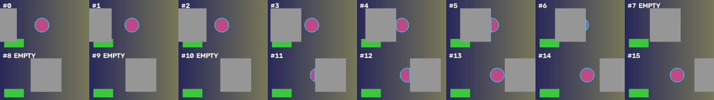
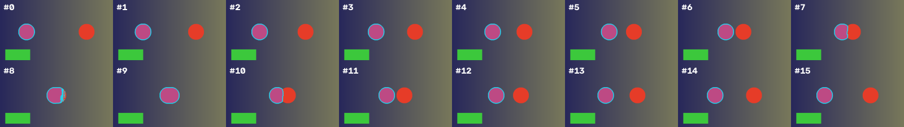

# 개발 기록 (Phase 1 ~ 5B-2)

> 포트폴리오용 요약은 [README.md](../README.md)에 있습니다. 이 문서는 단계별 구현, 측정, 테스트, 수정 기록을 그대로 보관합니다(2026-11-18 기준).


짧은 영상을 업로드하고, 객체를 클릭해 선택한 뒤, **Meta SAM 2.1 (Hiera Tiny)** 로 프레임 전체에 걸쳐 추적하고, 선택한 객체에 시각 효과(Neon Outline / Color Pop / Background Blur)를 적용해 MP4로 내보내는 웹 애플리케이션입니다.

> **현재 상태: Phase 5B-2 완료 (Modal T4 원격 GPU, 브라우저 전체 흐름 확인)** ([Phase 5B-2 문서](phase5b2/README.md))
>
> 이전 상태: Phase 4 완료 (CPU)
> 클릭한 프레임에서 **실제 SAM 2.1 추론**으로 마스크를 만들고, 공식 비디오 예측기로 이후 프레임에서 객체를 **실제로 추적**합니다. 그런 다음 추적된 구간에 효과를 적용해 **H.264 MP4로 내보내고 다운로드**할 수 있습니다. 다만 이 PC의 CPU에서는 추적이 프레임당 약 11~40초 걸려, 한 번에 최대 60프레임(30fps 기준 2초)까지만 추적합니다.

## 진행 상황

| Phase | 내용 | 상태 |
|---|---|---|
| 1 | 프론트엔드 + Mock 미리보기 | ✅ 완료 |
| 2 | SAM 2.1 단일 프레임 분할 | ✅ 완료 (현재 PC에서는 **CPU** 추론, 아래 참고) |
| 3 | 비디오 마스크 전파(추적) | ✅ 완료 (CPU, 작업당 최대 60프레임, [측정 결과](#phase-3-영상-추적-측정-결과-cpu)) |
| 4 | 시각 효과 + MP4 export (OpenCV/FFmpeg) | ✅ 완료 ([검증 결과](#phase-4-mp4-내보내기)) |
| 5A | GPU 추론 검증 (Google Colab) | ✅ 완료 (Tesla T4, [결과](#phase-5a-gpu-추론-검증-google-colab)) |
| 5B-1 | Colab GPU 추적 결과 가져오기 → 10초 전체 효과 + MP4 | ✅ 완료 (Tesla T4 fp16/fp32 300프레임, [결과](#phase-5b-1-결과-실제-colab-gpu-300프레임)) |
| 실제 영상 검증 | 사람·동물·사물 영상 + SA-V 정답, Colab T4 22회 | ✅ 완료 ([결과](realworld/README.md)). P0 버그(오디오 영상 MP4 마지막 프레임 누락) 수정 |
| 5B-2 | 원격 GPU 자동 연결 (Modal 서버리스, 분할·추적 모두 원격, 임베딩 공유) | ✅ 완료: Modal T4 배포, 브라우저에서 실제 720p 영상 클릭(약 1초) → 289프레임 추적(115초) → MP4 → 취소 확인 ([문서](phase5b2/README.md)) |

## 실행 모드: Live와 Mock

| 모드 | 진입 방법 | 상단 배지 | 동작 |
|---|---|---|---|
| **Live** (기본) | `http://localhost:5173` | `SAM 2.1 · CPU` (초록) | FastAPI 백엔드의 실제 SAM 2.1 추론 |
| **Mock** | `http://localhost:5173/?mode=mock` | `Mock mode` (주황) | 모델 없이 UI 흐름만 시뮬레이션 |

- 모드는 URL `?mode=` > 환경 변수 `VITE_API_MODE` > 기본값 `live` 순서로 결정됩니다.
- **Live 모드에서 백엔드나 모델이 실패해도 Mock 결과로 대체하지 않습니다.** 배지에 `Backend offline`, `Loading SAM 2.1…`, `Model failed to load` 같은 상태가 표시되고, 요청은 오류 메시지와 함께 실패합니다.
- 분할에 실패하면 방금 추가하거나 삭제한 점이 직전 상태로 되돌아갑니다. 점 목록과 마스크가 서로 어긋나지 않게 하기 위해서입니다.
- Mock 오류 시뮬레이션: `?mode=mock&mockFail=segment|track|oom|export`

## 하드웨어 호환성 검토 결과 (이 PC)

| 항목 | 값 |
|---|---|
| Python | 3.13.1 |
| GPU | GeForce MX150, 2GB VRAM, Pascal (compute capability 6.1) |
| NVIDIA 드라이버 | **419.72** (CUDA 10.1까지만 지원) |
| 설치한 PyTorch | 2.15.0+cpu |
| 추론 장치 | **CPU** (float32) |

**GPU를 사용하지 못하는 이유**
SAM 2는 PyTorch 2.5.1 이상이 필요하고, 그 PyTorch는 CUDA 11.8 이상으로 빌드되어 있습니다. CUDA 11.8 이상을 쓰려면 Windows 드라이버 **522 이상**이 필요합니다. 지금 드라이버(419.72)로는 최신 PyTorch의 CUDA 빌드가 동작하지 않으므로 CPU 빌드를 설치했습니다.

**GPU를 쓰려면 (사용자가 직접 진행)**
1. NVIDIA 드라이버를 최신 버전으로 업데이트합니다. 노트북은 제조사 드라이버가 필요할 수 있습니다.
2. `.venv-sam2`에 CUDA 12.6 빌드를 설치합니다: `pip install torch torchvision --index-url https://download.pytorch.org/whl/cu126`
   - 최신 CUDA 12.8 이상 빌드는 Pascal(sm_61) 커널이 빠져 있으므로 **cu126을 사용**해야 합니다.
3. 백엔드를 다시 시작하면 `OMS_DEVICE=auto`가 다음을 순서대로 검사하고, 모두 통과할 때만 CUDA를 사용합니다.
   - CUDA 사용 가능 여부
   - 현재 PyTorch 빌드에 sm_61 커널이 포함되어 있는지
   - 실제 연산 smoke test

**MX150 2GB에서 GPU 추론을 쓸 수 있을지에 대한 검토 (아직 측정 전)**
- **bfloat16을 가정하지 않습니다.** Pascal은 bf16 연산을 하드웨어로 지원하지 않으므로, 이미지 분할은 autocast 없이 **float32**로 실행합니다.
- **Flash Attention은 쓰지 않습니다.** SAM 2 코드가 compute capability 8.0 미만에서는 자동으로 끄고 math 커널을 사용합니다.
- **입력 영상을 줄여도 모델 메모리는 줄지 않습니다.** SAM 2는 모든 입력을 내부에서 **1024×1024로 리사이즈**하기 때문입니다. 그래서 이미지 인코더의 메모리 사용량은 영상 해상도와 거의 무관합니다.
- Hiera Tiny 가중치는 약 39M 파라미터, 156MB이고 1024² 추론 활성화 메모리가 추가됩니다. 2GB 안에 들어갈 가능성은 있지만 **실측 전에는 단정하지 않습니다.** GPU 메모리가 부족하면 `gpu_oom` 오류(503)를 반환하며, `OMS_DEVICE=cpu`로 다시 시작하면 CPU로 실행됩니다. 자동으로 CPU로 바꾸지는 않습니다.
- Phase 3의 비디오 예측기는 메모리 특징을 bfloat16으로 저장하는 코드(`sam2_video_predictor.py`)가 있어, Phase 3에서 따로 검토가 필요합니다.

## Phase 2 측정 결과 (CPU, Intel 4코어/8스레드 노트북)

| 항목 | 측정값 |
|---|---|
| 모델 로드 | 약 18초 (서버 시작 시 1회, 이후 요청 간 유지) |
| 워밍업(첫 추론) | 이미지 인코더 11~13초 |
| **새 프레임 첫 클릭** (이미지 인코더) | **5~14초** (실행마다 편차 큼, 발열 영향 추정) |
| **같은 프레임 추가 클릭** (마스크 디코더만) | **0.3~0.6초** (브라우저 왕복 약 0.8초) |
| 프로세스 메모리(RSS) | 약 230~410MB |
| CPU 스레드 수 | 4/6/8 스레드 비교 결과 유의미한 차이 없음, 기본값(4) 유지 |

- 같은 (세션, 프레임)에 대한 연속 클릭은 이미지 임베딩을 **재사용**합니다. 인코딩은 한 번만 하고 예측을 여러 번 실행하는 방식입니다.
- UI 사이드바의 **SAM 2.1 inference** 카드에 매 요청의 장치, 인코더/디코더 시간, 왕복 시간, 메모리, 마스크 점수가 표시됩니다.
- 이 수치는 이 PC의 CPU 기준입니다. "실시간"이라고 표현하지 않습니다.

## Phase 3: 영상 추적 측정 결과 (CPU)

### 구현 방식

- **공식 API 그대로 사용**: `build_sam2_video_predictor`로 만든 예측기에서 다음 순서로 호출합니다.
  1. `init_state`
  2. `add_new_points_or_box`: Phase 2에서 찍은 클릭(같은 좌표 변환)을 프롬프트 프레임에 넣음
  3. `propagate_in_video`: 정방향 전파
- **연속 프레임만 처리**: 추적 범위는 프롬프트 프레임부터 정방향으로 N개의 연속 프레임입니다. **프레임을 건너뛰거나 마스크를 복사하지 않습니다.** 각 프레임의 마스크는 모델이 직접 예측한 결과입니다.
- **가중치 공유**: `SAM2ImagePredictor`가 비디오 예측기의 모델을 같이 쓰므로, 가중치는 메모리에 한 번만 올라갑니다.
- **지연 프레임 로딩**: 공식 `init_state`는 모든 프레임을 1024×1024 텐서로 미리 올립니다(프레임당 12MB, 비동기 로더는 float64라서 24MB). 이 PC는 RAM이 7.6GB인데 다른 프로그램 때문에 여유가 0.4~0.7GB밖에 없습니다. 그래서 `init_state`를 호출하는 동안만 프레임 로더를 **필요한 프레임만 디스크에서 읽는 로더**로 바꿔 끼웁니다([frames.py](../backend/app/inference/frames.py)).
  - 전처리는 공식 `_load_img_as_tensor`와 평균/표준편차 정규화를 그대로 씁니다.
  - 공식 로더와 값이 같은지 테스트로 확인했습니다.
  - 덕분에 **메모리가 프레임 수와 무관하게 일정**합니다.
- **CPU와 CUDA 코드 분리**: 장치별 처리(동기화, 메모리 측정, OOM 판별, 상태 오프로딩, autocast)는 [runtime.py](../backend/app/inference/runtime.py)의 `CpuRuntime`과 `CudaRuntime`에만 있고, 모델 코드는 장치를 직접 분기하지 않습니다.
  - GPU 서버로 옮길 때는 `CudaRuntime` 정책만 바꾸면 됩니다. 예를 들어 Ampere 이상이면 bf16 autocast를 켜고, VRAM이 8GB 이상이면 상태 오프로딩을 끕니다.
- **백그라운드 작업**: 단일 워커 큐로 처리합니다.
  - 매 프레임 진행률, 프레임당 시간, ETA를 갱신합니다.
  - 취소는 프레임 사이에서 협조적으로 처리하고, **이미 추적한 프레임은 유지**합니다.
  - 원본 해상도 마스크를 `data/sessions/<id>/tracks/<job>/masks/*.png`에 저장합니다. Phase 4 export에서 사용할 예정입니다.
- **객체 소실과 마스크 급변 감지**: 마스크 면적이 0.02% 미만이면 "객체가 보이지 않음", 직전 프레임 대비 면적이 2배 이상 변하면 "마스크 급변"으로 표시하고 타임라인에 빨강/주황으로 보여 줍니다.

### 단계별 처리 속도 (같은 테스트 영상, 1회 측정씩)

`scripts/benchmark_tracking.py`로 측정했습니다. 원이 움직이는 640×360 영상에서 프레임별 정답 위치와 비교했습니다.

| 프레임 수 | 프레임당 평균 | 중앙값 | 최대 | 총 시간 | 최대 RAM | 정확도 (최소 IoU / 최대 중심 오차) | 객체 이동 거리 |
|---|---|---|---|---|---|---|---|
| 10 | 18.4초 | 14.4초 | 33.8초 | 3분 1초 | 605MB | 0.979 / 0.3px | 70px |
| 30 | 17.2초 | 16.6초 | 27.5초 | 8분 49초 | 541MB | 0.979 / 0.3px | 191px |
| 60 | 25.4초 | 21.8초 | 63.6초 | 25분 29초 | 569MB | 0.979 / 0.3px | 156px |

- **정확도는 60프레임까지 떨어지지 않았습니다.** 마스크가 실제로 객체를 따라갑니다.
- 각 측정은 1회씩이라 실행마다 편차가 있습니다. 시나리오 테스트에서는 프레임당 평균 11~17초가 나왔습니다.
- **병목** (forward hook으로 단계별 측정, 프레임당):

  | 단계 | 시간 | 비중 |
  |---|---|---|
  | 이미지 인코더(Hiera) | 8.2초 | 48% |
  | **메모리 어텐션** | **7.2초** | **42%** |
  | 마스크 디코더 + 메모리 인코더 | 1.2초 | 8% |

  - 메모리 어텐션은 현재 프레임 4,096 토큰이 최대 7개 메모리 프레임(약 28,700 토큰)을 4개 층에서 참조하는 구조라 비용이 큽니다.
  - CPU용 어텐션 커널(flash, math, auto)을 비교해 봤는데 PyTorch 자동 선택이 이미 가장 빨랐습니다.
  - CPU 스레드 수(4/6/8)도 효과가 없었습니다.
- **60프레임 측정이 더 느렸던 이유(추정)**: 모델 구조상 메모리 크기는 16프레임 이후 더 늘지 않습니다(`num_maskmem=7`, 객체 포인터 최대 16개). 그래서 25분 동안 이어진 실행 중 **CPU 발열과 스왑(4.5GB 사용 중)** 이 원인이었을 것으로 봅니다.
- **결정한 처리 범위**: CPU에서는 작업당 **최대 60프레임**으로 제한합니다. 화면 기본값은 10프레임(약 3분)입니다.
  - 300프레임 전체는 1.5~2시간이 걸리므로 CPU에서는 막아 두었습니다.
  - 한도는 `OMS_MAX_TRACK_FRAMES_CPU` 환경 변수로 바꿀 수 있고, CUDA에서는 300입니다.

### 객체가 사라지거나 마스크가 틀리는 경우

[tests/scenarios.py](../backend/tests/scenarios.py)의 합성 장면은 정답을 정확히 알고 있습니다. 결과 이미지는 [docs/phase3/](phase3/)에 있습니다.

| 장면 | 결과 |
|---|---|
| **moving**: 곡선 경로로 이동 (12프레임) | ✅ 모든 프레임 IoU 0.977 이상, 중심 오차 0.3px 이하 |
| **exit**: 화면 밖으로 나감 (14프레임) | ✅ 일부만 보일 때도 IoU 0.976 이상으로 정확함. 완전히 나간 뒤(10~13)에는 **빈 마스크**가 나오고 "객체 소실"로 표시됨. 다른 물체를 잘못 잡지 않음 |
| **occlusion**: 회색 판이 완전히 가렸다가 지나감 (16프레임) | ✅ 가려진 동안(7~10)에는 빈 마스크로 소실 표시. 판이 지나간 뒤 **자동으로 다시 찾음** (IoU 0.973 → 0.988) |
| **distractor**: 똑같은 원이 교차함 (16프레임) | ❌ **정체성 뒤바뀜**: 겹친 뒤(10번째 프레임부터) 다른 원을 따라감 (IoU 0.0). 면적이 일정해서 **급변 감지로도 잡히지 않음** |




## Phase 4: MP4 내보내기

### 구현 방식

- **SAM 2를 다시 실행하지 않음**: Phase 3 추적 작업이 저장한 원본 해상도 마스크(`tracks/<추적 작업>/masks/*.png`)만 읽습니다.
  - 검증 스크립트는 추적이 끝난 뒤 **모델을 메모리에서 제거하고** 내보내기를 실행했습니다.
  - 효과를 바꿔 다시 내보내도 같은 추적 결과를 재사용합니다. 브라우저에서 같은 추적 작업과 같은 마스크 객체가 그대로 유지되는 것을 확인했습니다.
- **추적된 구간만 내보냄**: 추적된 연속 프레임(예: 1~10)만 출력합니다. 추적하지 않은 구간은 넣지 않고, 임의의 마스크도 만들지 않습니다.
- **효과 렌더러**([effects.py](../backend/app/effects.py)): 프론트엔드 Canvas 렌더러([renderer.ts](../frontend/src/lib/renderer.ts))의 연산을 그대로 옮겼습니다.
  - 파라미터 공식은 `effectParams.ts`와 같습니다. 해상도에 비례하므로 960px 미리보기와 1080p 출력의 모양이 같습니다.
  - 색 변환: CSS `grayscale()`과 `saturate()`의 명세 색 행렬을 씁니다.
  - 블러: CSS `blur(r)`처럼 표준편차 r인 가우시안이고, Canvas처럼 경계 밖을 투명으로 처리합니다.
  - 네온: Canvas `shadowBlur`처럼 표준편차 b/2인 그림자로 빛 번짐을 만들고, 링을 2회 + 선명한 선 1회 그립니다.
- **원본 프레임**: `input.mp4`를 OpenCV로 순차 디코딩합니다. 업로드 때 프레임 번호를 매긴 방식과 같습니다. 세션 JPEG를 쓰지 않으므로 손실 압축이 한 번 더 들어가지 않습니다.
- **인코딩**: 렌더링한 프레임을 stdin으로 FFmpeg에 넘깁니다.
  - 코덱: `libx264`, `yuv420p`, CRF 18, `+faststart`
  - **프레임레이트는 ffprobe로 읽은 원본의 정확한 유리수 값**(예: `30000/1001`)을 그대로 씁니다.
  - 원본에 오디오가 있으면 같은 시간 구간을 잘라 AAC로 넣습니다.
  - 홀수 해상도는 오른쪽과 아래에 1px을 패딩해 짝수로 맞춥니다. 원본 픽셀은 자르지 않습니다.
- **작업 처리**: 별도의 `export` 큐에서 실행하므로 추적 작업 뒤에서 기다리지 않습니다.
  - 매 프레임 진행률을 갱신합니다.
  - 취소하면 FFmpeg를 종료하고 작업 폴더를 삭제합니다.
  - 실패 시 FFmpeg 로그의 끝부분을 오류 메시지에 담고 폴더를 정리합니다.
  - 성공하면 `output.part.mp4`의 이름을 `output.mp4`로 바꾼 뒤 **ffprobe로 다시 검증**합니다(프레임 수, FPS, 길이, 해상도, 코덱).
- **다운로드**: `GET /api/exports/{job}/download`가 `video/mp4` 파일을 첨부로 보냅니다. 파일명 예시: `object-magic_neon-colorpop_f1-10.mp4`
- **FFmpeg**: ffmpeg.org가 안내하는 Windows 배포본(gyan.dev release essentials 9.0.2)을 쓰고, SHA-256을 검증했습니다.
  - 설치 위치는 프로젝트 안(`backend/third_party/ffmpeg/`)이며 **시스템 PATH는 바꾸지 않았습니다.**
  - 탐색 순서: `OMS_FFMPEG` 환경 변수 → 프로젝트 로컬 → PATH

### 검증 결과 (실제 SAM 2.1 추적 10프레임 → 효과별 MP4)

`scripts/phase4_export_check.py` 결과입니다. MP4 파일과 비교 이미지, `report.json`은 [docs/phase4/](phase4/)에 있습니다.

| 항목 | 640×360 | 1920×1080 |
|---|---|---|
| 추적 마스크 정확도 (정답 원 대비 최소 IoU) | 0.978 | 0.985 |
| ffprobe: 프레임 수 / FPS / 길이 | 10 / 30 (30/1) / 0.3333초 | 10 / 30 / 0.3333초 |
| 코덱, 해상도 | h264 yuv420p, 640×360 | h264 yuv420p, 1920×1080 |
| 무손실 기준 렌더 대비 PSNR | 37.5~40.6dB | 38.0~41.1dB |
| **Color Pop**: 배경 채도 / 객체 채도 / 채색 영역 중심 오차 | 1.0 / 242 / ≤0.25px | 1.0 / 242 / ≤0.33px |
| **Blur**: 객체 내부 변화 / 배경 경계 변화 | ≈1.1 (코덱 오차) / 23.6 | ≈1.0 / 24.3 |
| **Neon**: 링 색 오차 / 먼 배경 변화 | 16~19 / 2.0 | 8~9 / 2.0 |

- PSNR은 같은 마스크와 같은 코드로 만든 무손실 렌더와 비교한 값입니다. 차이는 H.264 압축 손실뿐입니다.
- 640 해상도의 네온 링 색 오차가 더 큰 이유: 3px 선이 yuv420p의 색 해상도 절반 샘플링 때문에 번지기 때문입니다.
- 정확한 NTSC 프레임레이트(`30000/1001`), 오디오 유지, 홀수 해상도(321×181 → 322×182) 처리는 [test_export.py](../backend/tests/test_export.py)로 검증했습니다.

### 미리보기와 결과물의 일치 검증 (브라우저)

1080p 영상을 실제로 추적한 뒤 비교했습니다.
- **미리보기**: 브라우저 Canvas, 960×540
- **결과물**: 서버 렌더링(`render-frame`, 내보내기와 같은 코드), 1920×1080을 960×540으로 축소

| 효과 | 평균 차이 (0~255) | 효과 없이 원본끼리 비교한 차이(기준선) | 효과 적용 영역 IoU |
|---|---|---|---|
| Color Pop | 2.66~2.68 | 2.18~2.19 | 0.998 |
| Neon | 2.22~2.23 | 2.18~2.19 | 0.983~0.986 |
| Blur | 2.09~2.11 | 2.18~2.19 | 0.909 |

- 기준선 차이는 브라우저 디코더와 OpenCV 디코더의 차이, 그리고 축소 방식의 차이에서 생깁니다. 효과가 더하는 차이는 0~0.5 수준입니다.
- Blur의 영역 IoU가 낮은 이유: 블러는 경계로 갈수록 변화가 서서히 0이 되므로, 고정 임계값(12)으로 영역을 자를 때 가장자리가 조금씩 달라집니다. 평균 차이는 오히려 기준선보다 작습니다.

### 성능 (CPU)

| | 효과 렌더링 (프레임당) | 10프레임 내보내기 총 시간 |
|---|---|---|
| 640×360 Neon / Color Pop / Blur | 180 / 78 / 140ms | 2.3 / 1.3 / 1.9초 |
| 1920×1080 Neon / Color Pop / Blur | 1,785 / 530 / 1,415ms | 19.0 / 7.2 / 15.8초 |
| 1920×1080 세 효과 모두 (브라우저) | 3,169ms | 33.8초 |

내보내기는 추적(프레임당 15~40초)에 비하면 짧습니다. 1080p의 네온과 블러는 큰 반경의 가우시안을 원본 해상도에서 계산하기 때문에 느립니다.

## Phase 5A: GPU 추론 검증 (Google Colab)

> **상태**: Colab **Tesla T4**에서 실제 SAM 2.1 추론을 실행했습니다(사용자가 실행, 2026-11-13). 원본 결과는 [docs/phase5a/](phase5a/)에 있습니다.

### GPU 결과 요약 (Tesla T4 vs 로컬 CPU, 같은 체크포인트·커밋·입력 프레임)

실행 환경: Tesla T4, compute capability 7.5, 15GB, PyTorch 2.14.1 + CUDA 13.0, 드라이버 580.82.07
- 체크포인트 SHA-256과 SAM 2 커밋(`2b90b9f5`)이 로컬과 같음을 확인했습니다.
- T4는 bf16을 하드웨어로 지원하지 않아 **bf16 실험은 건너뛰었습니다**(자동 판정).

| 항목 | CPU (로컬) | GPU fp32 | GPU fp16 |
|---|---|---|---|
| 모델 로드 | 23.3초 | 10.2초 (첫 실행, CUDA 초기화 포함) | 3.6초 |
| 이미지 인코더 (중앙값) | 8,226ms | **160ms (×51)** | **125ms (×66)** |
| 마스크 디코더 (중앙값) | 302ms | 9.8ms (×31) | 12.2ms |
| 추적, 프레임당 (60프레임 평균) | 16,820ms | **411ms (×41)** | **181ms (×93)** |
| 추적 FPS (안정 구간) | 0.06 | 2.3~2.4 | 5.4~5.5 |
| **300프레임(10초) 추적** | 미측정 (추정 약 84분) | **132초**, 최대 GPU 메모리 952MB (예약 1,298MB) | **56초**, 804MB (예약 1,012MB) |
| 300프레임 + 상태 오프로딩 | — | 132초 (속도 변화 없음), **713MB** (예약 1,076MB) | — |

- **프레임당 시간의 변화**: 첫 프레임 약 250ms에서 시작해 16프레임 전후부터 일정해집니다(fp32 약 440ms, fp16 약 180ms). 메모리 뱅크(7프레임)와 객체 포인터(최대 16개)가 다 찰 때까지 연산량이 늘기 때문입니다.
- **메모리**: 300프레임 fp32는 952MB 할당, 1.3GB 예약으로, T4 15GB의 10% 미만입니다. 프레임당 약 0.75MB씩 늘어납니다. 오프로딩을 켜면 할당량이 25% 줄고(952 → 713MB) **속도는 거의 같았습니다**(438.3 → 438.6ms).

### 마스크 품질 비교

| 비교 | 결과 |
|---|---|
| GPU fp32 vs CPU: 분할 6개 프롬프트 | **IoU 1.0000 (동일)** |
| GPU fp32 vs CPU: 추적 30/60프레임, 300프레임의 앞 60프레임 | **IoU 1.0000 (동일)** |
| GPU fp32 vs CPU: 10프레임 추적 (같은 길이로 실행한 CPU 결과와 비교) | IoU 1.0 (동일) |
| GPU fp16 vs CPU: 분할 | IoU 0.9999~1.0 |
| GPU fp16 vs CPU: 추적 | 최소 0.9888, 평균 0.995 |
| GPU fp16 vs GPU fp32: 300프레임 | 최저 0.9872 (83번째 프레임, 경계 124px 차이) |
| 정답(GT) 대비 300프레임 | fp32 최소 0.9789 / 평균 0.9879, fp16 최소 0.9776 / 평균 0.9862 |

- **fp32 GPU는 CPU와 같은 마스크를 만듭니다.**
- **fp16은 2.3배 빠르고**, 정답 대비 정확도 차이는 0.001~0.002 수준입니다. CPU/fp32 결과와 비교하면 경계에서 최대 약 1%가 달라집니다.
- **비교 방법 정정**: 처음에는 "CPU에서 다시 실행해도 IoU 0.997 정도의 잡음이 있다"고 판단했는데, 원인 분석 결과 틀린 판단이었습니다. 공식 SAM 2 코드는 객체 포인터 수를 `min(num_frames, 16)`으로 정합니다(`sam2_base.py:588`). 그래서 **16프레임보다 짧은 실행은 긴 실행의 앞부분과 계산이 조금 다릅니다.** 같은 길이로 실행하면 CPU와 GPU fp32가 완전히 같습니다(IoU 1.0).

### 이 결과의 의미와 한계

- 웹앱의 "작업당 60프레임" 제한은 CPU 때문이었습니다. T4급 GPU에서는 **10초(300프레임) 전체 추적이 fp32 약 2분, fp16 약 1분**이고, 메모리도 충분합니다.
- 이 수치는 **Colab T4 기준**입니다. 로컬 MX150(Pascal, 2GB, Tensor Core 없음)에서는 fp16 autocast를 쓸 수 없고, 속도도 T4보다 훨씬 느릴 것입니다. 메모리 측면에서는 300프레임 fp32가 1.0~1.3GB 예약(오프로딩 시 1.1GB)이라 2GB 안에 들어갈 가능성이 있지만, **실측하지 않았습니다.**
- 1회 실행 결과입니다. Colab GPU는 공유 자원이라 실행마다 달라질 수 있습니다.
- 웹앱은 원격 GPU에 연결하지 않았습니다(이번 범위 밖).

### 준비한 것

- **공통 벤치마크 코드** [gpu_benchmark.py](../backend/scripts/gpu_benchmark.py)
  - 로컬 CPU와 Colab GPU에서 **같은 `app/` 추론 코드**(Sam2Engine, Sam2ImageService, VideoTracker)를 그대로 실행합니다.
  - `run`: 환경 정보, 모델 로딩, 단일 프레임 분할(4가지 클릭 조합, 프레임 1·101·201), 10/30/60/300프레임 추적을 실행합니다.
    - 기록 항목: 로딩 시간, 프레임당 시간, FPS, 최대 GPU 메모리(할당/예약), 정답과 CPU 기준 대비 IoU
  - `summarize`: 여러 실험과 CPU 기준을 한 표로 정리합니다.
  - 실험 하나가 실패해도(예: 300프레임 OOM) 오류를 기록하고 다음 실험으로 넘어갑니다.
- **정밀도와 오프로딩 옵션** ([runtime.py](../backend/app/inference/runtime.py), 환경 변수 `OMS_PRECISION`, `OMS_OFFLOAD_STATE`)
  - `fp32`(기본), `fp16` autocast(compute capability 7.0 이상), `bf16` autocast(**하드웨어 지원 GPU에서만**, T4/MX150은 거부)
  - CPU는 fp32만 허용합니다. 웹앱의 기본 동작은 바뀌지 않습니다.
  - 상태 오프로딩: `auto`(VRAM 8GB 미만이면 켬), `on`, `off`. 공식 `offload_state_to_cpu` 옵션을 씁니다.
- **동일 조건 보장** (Colab 번들 `colab/build/oms_phase5a_bundle.zip`, 2.4MB)
  - 같은 입력: 로컬에서 추출한 **JPEG 프레임 300장**(10초 테스트 영상)을 그대로 넣어 디코더 차이를 없앴습니다.
  - 같은 체크포인트: Colab에서 공식 URL로 받은 뒤 로컬 파일의 **SHA-256**(`7402e0d8…`)과 비교합니다.
  - 같은 SAM 2 코드: 로컬과 같은 커밋 `2b90b9f5`를 설치합니다. 선택적 CUDA 확장(`_C`)도 로컬과 같이 빌드하지 않습니다.
  - Colab의 CUDA PyTorch는 그대로 둡니다(`--no-deps --no-build-isolation`). 설치 후 torch 버전이 바뀌지 않았는지 확인합니다.
- **Colab 노트북** [colab/phase5a_gpu_benchmark.ipynb](../colab/phase5a_gpu_benchmark.ipynb)
  1. GPU, CUDA, PyTorch 호환성 확인
  2. 번들 업로드
  3. SAM 2 설치
  4. 체크포인트 검증
  5. fp32 실험(분할 + 10/30/60/300)
  6. fp16 실험, bf16 실험(지원 시에만)
  7. 오프로딩 300프레임 실험
  8. 요약
  9. 결과 다운로드

### CPU 기준 결과 (로컬, 같은 번들 데이터)

| 항목 | 값 |
|---|---|
| 모델 로드 | 23.3초 |
| 이미지 인코더 (중앙값) | 8.2초 |
| 마스크 디코더 (중앙값) | 0.30초 |
| 분할 IoU (정답 대비) | 0.985~0.994 |
| 60프레임 추적: 프레임당 평균 / FPS | 16.8초 / 0.059 |
| 60프레임 추적: 총 시간 | 16분 51초 |
| 추적 IoU (정답 대비, 최소/평균) | 0.979 / 0.989 |

- 같은 CPU에서 다시 실행하면 분할은 IoU 1.0으로 동일합니다. 추적은 **길이가 다른 실행끼리** 비교하면 IoU 0.997 정도 차이가 납니다(16프레임 미만에서 객체 포인터 수가 다르기 때문, 위 "비교 방법 정정" 참고). 같은 길이로 실행하면 동일합니다.
- 300프레임 CPU 기준은 만들지 않았습니다(예상 1.5시간 이상). 300프레임 결과는 정답(GT)과 비교하고, 앞 60프레임은 CPU 기준과 비교합니다.

### Colab에서 직접 실행할 단계

1. 로컬에 번들이 있는지 확인합니다: `colab/build/oms_phase5a_bundle.zip`. 없으면 아래 "번들 다시 만들기"를 실행합니다.
2. https://colab.research.google.com 에서 **파일 → 노트북 업로드**를 눌러 `colab/phase5a_gpu_benchmark.ipynb`를 엽니다.
3. **런타임 → 런타임 유형 변경 → T4 GPU**(또는 사용 가능한 GPU)를 선택하고 저장합니다.
4. **런타임 → 모두 실행**을 누릅니다. 2번 셀에서 파일 선택 창이 열리면 `oms_phase5a_bundle.zip`을 선택합니다.
5. 마지막 셀이 `phase5a_results.zip`을 다운로드합니다. 이 파일을 **`colab/results/`** 폴더에 넣습니다.
6. 로컬에서 요약을 다시 만들려면(`backend/`에서): `python scripts/gpu_benchmark.py summarize <압축 해제한 results/*> --reference ../colab/build/reference/cpu`

번들 다시 만들기 (로컬, `backend/`에서 실행):
```powershell
python ..\scripts\make_test_clip.py ..\colab\build\test_10s.mp4 10
.venv-sam2\Scripts\python -c "import sys; sys.path.insert(0,'.'); from pathlib import Path; from app.media import extract_frames; extract_frames(Path('../colab/build/test_10s.mp4'), Path('../colab/build/data/frames'))"
.venv-sam2\Scripts\python scripts\gpu_benchmark.py run --frames-dir ..\colab\build\data\frames --out ..\colab\build\reference\cpu --label cpu_fp32_reference --device cpu --segment --track 60
.venv-sam2\Scripts\python scripts\make_colab_bundle.py
.venv-sam2\Scripts\python scripts\make_colab_notebook.py ..\colab\phase5a_gpu_benchmark.ipynb
```

## Phase 5B-1: Colab GPU 추적 결과 가져오기

CPU 추적 한도(60프레임)는 그대로 두고, **Colab GPU에서 추적한 결과를 파일로 주고받아** 10초(300프레임) 영상 전체에 효과를 적용하고 내보냅니다. 웹앱과 Colab을 직접 연결하지 않습니다. 사용자가 파일을 한 번 올리고 내려받는 일회성 작업입니다.

```
웹앱 ──(1) GPU 작업 파일 zip──▶ Colab 노트북 ──(2) 결과 zip──▶ 웹앱 (검증 → 추적 결과로 등록 → 효과/MP4)
```

### 파일 형식 ([gpu_jobs.py](../backend/app/gpu_jobs.py), 서버와 Colab이 같은 코드 사용)

- **GPU 작업 파일** `oms_gpu_job_<id>_<N>f_<precision>.zip` (oms-gpu-job v1)
  - `job.json`: 영상 SHA-256, 해상도, FPS(유리수), 프레임 수, 클릭 프롬프트(정규화 좌표 + 원본 픽셀), 추적 구간, 체크포인트 SHA-256, SAM 2 커밋, 정밀도, 프레임별 SHA-256
  - `frames/*.jpg`: 서버가 업로드 때 추출한 프레임을 그대로 넣습니다. CPU 추적과 같은 입력이므로 디코더 차이가 없습니다.
  - `app/`, `scripts/colab_track.py`: 서버와 **같은 추론 코드**(Sam2Engine + VideoTracker, 공식 SAM2VideoPredictor)
- **결과 파일** `oms_gpu_result_<id>_<precision>.zip` (oms-gpu-result v1)
  - `result.json`: 작업 정보 사본, 실행 환경(장치, GPU, 정밀도, 버전), 측정값, 마스크별 SHA-256
  - `masks/NNNNN.png`: 영상 전체 기준 프레임 번호, 원본 해상도, 8-bit 이진(0/255) 마스크

### 가져오기 검증 (하나라도 틀리면 거부, 오류 코드 `invalid_result`)

- **형식과 버전**, zip 경로 안전성(`..`, 절대 경로, 예상 밖의 파일)
- **서버가 만든 작업과 일치**: jobId(서버 `data/gpu_jobs/`에 기록, 14일 보관), 프롬프트, 추적 구간
- **현재 영상과 일치**: SHA-256, 해상도, FPS, 프레임 수
  - 세션 ID가 아니라 **영상 해시**로 확인합니다. 그래서 Colab을 실행하는 동안 서버를 재시작하거나 브라우저를 새로 고쳐도, 같은 영상을 다시 올리면 가져올 수 있습니다.
- **모델**: 체크포인트 SHA-256이 서버와 같아야 하고, 정밀도는 fp16 또는 fp32만 허용합니다.
- **프레임 한도**: `device=cuda` 결과는 최대 300프레임, CPU로 만든 결과는 CPU 한도(60)까지만 허용합니다.
- **마스크**:
  - 모든 프레임이 순서대로 있어야 하고, SHA-256이 일치해야 합니다.
  - PNG로 디코딩되고, 8-bit 단일 채널이며, 크기가 영상과 같고, 값이 0과 255뿐이어야 합니다.

검증을 통과하면 일반 추적 결과(Job)로 등록됩니다. 그 결과 **미리보기, 타임라인, 객체 소실 표시, MP4 내보내기를 그대로 씁니다.** 효과를 바꿔도 재추론하지 않습니다.

### 웹앱 사용법 (오른쪽 **GPU tracking (Colab)** 패널)

1. 객체를 클릭한 뒤 정밀도를 고르고(**fp16 기본**, fp32 선택 가능) **1. Download GPU job**을 누릅니다. 프롬프트 프레임부터 최대 300프레임이 들어갑니다.
2. Colab에서 [colab/phase5b_gpu_tracking.ipynb](../colab/phase5b_gpu_tracking.ipynb)를 열고 **T4 GPU** 런타임을 선택한 뒤 **모두 실행**합니다. 파일 선택 창에서 작업 zip을 고릅니다.
   - `ALSO_RUN_FP32 = True`로 바꾸면 fp32 결과도 함께 만들어 비교할 수 있습니다.
3. 내려받은 결과 zip을 **2. Import GPU result**로 가져옵니다.
4. **Tracking results** 목록에서 결과(로컬 CPU / GPU fp16 / GPU fp32)를 전환합니다.
   - **Compare with active**를 누르면 두 결과의 프레임별 IoU를 보여 줍니다.
   - 효과 설정은 결과를 바꿔도 유지됩니다.
5. **Export MP4**: 가져온 구간 전체(최대 10초)를 내보냅니다.

### 로컬 검증 (GPU 없이)

- 백엔드 테스트 [test_gpu_jobs.py](../backend/tests/test_gpu_jobs.py) 27개:
  - 작업 파일 내용
  - 가져오기 → 추적 결과 등록 → 프레임마다 다른 마스크 → MP4 내보내기
  - 새 세션에서 같은 영상으로 가져오기
  - fp16/fp32 비교
  - GPU 결과 80프레임 허용, CPU 결과 거부
  - **잘못된 결과 파일 18종 거부**: 영상 해시, 프레임 수, FPS, 해상도, 프롬프트, 체크포인트, 정밀도, 형식, 버전, 구간, 일부만 있는 결과, 마스크 누락, 추가 파일, 경로 조작, 변조된 마스크, 이진이 아닌 마스크, RGB 마스크, 크기가 다른 마스크
  - 다른 영상의 결과, 알 수 없는 작업, zip이 아닌 파일 거부
  - **300프레임 가져오기 → 10.00초 MP4**(300프레임, 30fps) 내보내기 + 25프레임마다 채색 영역 중심이 마스크 위치와 일치(프레임 순서 확인)
- [test_gpu_pipeline_real.py](../backend/tests/test_gpu_pipeline_real.py): 서버가 만든 작업 zip을 빈 폴더에 풀고, 그 안의 `colab_track.py`를 **실제 SAM 2.1 모델로 별도 프로세스에서 실행**(CPU fp32, 4프레임)합니다. 결과를 가져오면 마스크 중심이 정답 원과 2px 이내로 일치합니다.
- 브라우저: 10초 영상 업로드 → 클릭 → **300프레임 fp16 작업 파일 생성(4초, 3.5MB)** → 잘못된 결과 파일은 명확한 오류로 거부되는 것을 확인했습니다.
- 브라우저 메모리: 300프레임 마스크는 RLE로 보관하고 필요할 때만 디코딩합니다(최근 16장). 마스크 캔버스도 최근 8장만 유지합니다.

### Phase 5B-1 결과 (실제 Colab GPU, 300프레임)

입력: `test_10s.mp4`(640×360, 30fps, 300프레임), 프레임 1에서 원을 클릭. 작업 파일 `891914ea`(fp16)을 Colab **Tesla T4**에서 fp16과 fp32로 각각 실행했습니다(사용자 실행, 2026-11-13).

**GPU 추적 (Colab, `result.json` 기록값)**

| | fp16 (기본) | fp32 (비교) |
|---|---|---|
| 프레임당 평균 / 중앙값 / 최대 | **179 / 176 / 300ms** | 455 / 458 / 576ms |
| 추적 FPS | **5.58** | 2.20 |
| 300프레임 추적 시간 | **56.5초** | 137.7초 |
| GPU 메모리 최대 (할당 / 예약) | 793 / 996MB | 936 / 1,286MB |
| 정답 대비 IoU (최소 / 평균) | 0.9776 / 0.9865 | 0.9789 / 0.9879 |
| 정답 대비 마스크 중심 오차 (최대) | 0.40px | 0.37px |
| fp16 vs fp32 | IoU 최소 0.9870 (238번째 프레임, 125px) / 평균 0.9956 | |

**웹앱 가져오기 → 효과 → 10초 MP4 (브라우저에서 실제 UI로 진행)**

- **세션 무관 가져오기 확인**: 작업 파일을 만든 세션이 아니라 **새 세션**에서 같은 영상을 다시 올린 뒤 가져왔습니다.
- **fp16 결과**: 검증과 등록에 13초 걸렸고, 300프레임 전체가 추적 결과로 등록됐습니다. 클릭 프롬프트도 복원됐습니다.
- **fp32 결과**를 추가로 가져와 **Compare with active**로 비교했습니다. 앱에 표시된 값(IoU 최소 0.9870, 평균 0.9956)이 직접 계산한 값과 같았습니다.
- **효과 보존**: fp32 → fp16으로 결과를 바꿔도 효과 설정이 그대로 유지됐고, 재추론은 없었습니다.
- **미리보기 마스크**(필요할 때만 디코딩): 프레임 1/76/151/226/300의 중심이 정답 원과 0.3px 이내였습니다.
- **Neon + Color Pop 10초 내보내기**: 51.7초(효과 적용 프레임당 167ms), 196KB. 브라우저에서 640×360, **10.000초**로 재생됐습니다.
- **잘못된 가져오기 거부**: 다른 영상(5초, 150프레임) 세션에 같은 결과를 가져오면 "different video (sha256 mismatch)"로 거부되고, 상태가 바뀌지 않았습니다.

**출력 MP4 정밀 검증** ([verify_full_export.py](../backend/scripts/verify_full_export.py), 결과는 [docs/phase5b1/](phase5b1/))

| 항목 | 결과 |
|---|---|
| ffprobe | h264, yuv420p, 640×360, `30/1`, nb_frames **300**, duration **10.000000초** |
| 프레임별 PTS | 0 ~ 9.966667초, 모두 정확히 i/30 (최대 오차 0), 단조 증가 |
| **프레임 순서** | 300프레임 중 **299개 정확히 일치**, 1개는 원이 거의 멈춰(이동 1px 미만) 구분 불가, **틀린 프레임 0** |
| **효과 위치** | Color Pop 채색 영역 중심이 가져온 마스크와 **최대 0.34px**, 정답 원과 **최대 0.40px** 차이 (300프레임 전부) |
| 네온 링 | 300/300 프레임에서 마스크 경계에 네온 색 확인 |
| 무손실 기준 렌더 대비 PSNR | 35.8~36.2dB (H.264 압축 손실 수준) |

**검증 과정에서 바로잡은 점**
- 처음 만든 "프레임 순서" 지표는 Color Pop 출력과 원본 컬러를 서로 다른 흑백 변환 공식으로 비교해서 125/300이라는 잘못된 수치가 나왔습니다. 측정 방법을 고쳤습니다(객체 중심과 300프레임 전체의 정답 위치 비교, 무손실 기준 렌더 PSNR).
- 전체 테스트를 한 번 실행했을 때 2시간 34분이 걸리며 1개(내보내기 대기 60초 타임아웃)가 실패했습니다. 같은 코드로 다시 실행하면 해당 파일과 전체(94개, 92초) 모두 통과해 재현되지 않았습니다. 테스트가 경과 시간을 벽시계로 재므로, 실행 중 PC 절전이나 CPU 부족 같은 환경 요인으로 추정하지만 원인은 확인하지 못했습니다.

### Colab에서 직접 실행하는 단계 (다른 영상에 쓸 때)

1. 웹앱에서 **1. Download GPU job**으로 작업 파일을 만듭니다. 예시: `colab/jobs/oms_gpu_job_891914ea_300f_fp16.zip`
2. https://colab.research.google.com → **파일 → 노트북 업로드** → `colab/phase5b_gpu_tracking.ipynb`
3. **런타임 → 런타임 유형 변경 → T4 GPU**
4. 설정 셀에서 `ALSO_RUN_FP32 = True`로 바꿉니다(fp16/fp32 비교용).
5. **런타임 → 모두 실행**을 누르고, 파일 선택 창에서 위 작업 zip을 선택합니다.
6. 내려받은 결과 zip을 웹앱의 **2. Import GPU result**로 가져옵니다.

## 기술 스택

- **Frontend**: React 18, TypeScript, Tailwind CSS v4, Vite 6, Zustand, Vitest
- **Backend**: Python 3.13, FastAPI, OpenCV, PyTorch
- **Model**: Meta SAM 2.1 Hiera Tiny: 공식 [`facebookresearch/sam2`](https://github.com/facebookresearch/sam2) 저장소, 공식 체크포인트, `SAM2ImagePredictor` 사용

## 프로젝트 구조

```
object-magic-studio/
├── frontend/
│   ├── src/
│   │   ├── api/            # StudioApi 계약, httpApi(Live), mockApi(Mock), 모드 결정, 오류 처리
│   │   ├── components/     # VideoStage, Timeline, SelectionPanel, EffectsPanel, ExportPanel, ModeBadge ...
│   │   ├── lib/            # 좌표 정규화, 검증, 프레임 계산, RLE, 이펙트 파라미터, 캔버스 렌더러
│   │   ├── store/          # Zustand 전역 상태
│   │   └── types.ts
│   └── test-fixtures/      # 브라우저 테스트용 샘플 영상 (빌드에 포함되지 않음)
├── backend/
│   ├── app/
│   │   ├── main.py         # FastAPI 엔드포인트
│   │   ├── config.py       # 설정 (검증 한도, 경로, OMS_DEVICE)
│   │   ├── sessions.py     # 세션별 격리 디렉터리 관리
│   │   ├── media.py        # 영상 검증, 프레임 추출 (OpenCV)
│   │   ├── masks.py        # 좌표 변환, 마스크 리샘플, RLE
│   │   ├── errors.py       # 일관된 오류 응답
│   │   ├── jobs.py         # 백그라운드 작업 (큐별 단일 워커, 진행률, 협조적 취소, 외부 결과 등록)
│   │   ├── gpu_jobs.py     # GPU 작업/결과 파일 형식과 검증 (서버·Colab 공용)
│   │   └── inference/
│   │       ├── device.py      # 장치 선택 + CUDA 호환성 진단
│   │       ├── runtime.py     # CPU/CUDA별 실행 정책 (동기화, 메모리, OOM, 오프로딩)
│   │       ├── engine.py      # 모델 1회 로드, 이미지/비디오 예측기 가중치 공유, 연산 직렬화
│   │       ├── frames.py      # 지연 프레임 소스 (메모리 일정)
│   │       ├── sam2_image.py  # 단일 프레임 분할 (임베딩 캐시, 측정)
│   │       └── sam2_video.py  # 영상 추적 (init_state → add_new_points_or_box → propagate_in_video)
│   ├── tests/              # pytest (API, 작업, 프레임 로더, 실제 SAM 2.1 분할/추적, 합성 장면)
│   │   ├── effects.py      # 출력용 효과 렌더러 (Canvas 미리보기와 같은 연산)
│   │   ├── exporter.py     # 마스크 재사용 + FFmpeg 인코딩, 취소/오류 정리, ffprobe 검증
│   │   ├── ffmpeg.py       # FFmpeg/ffprobe 탐색 (환경 변수 → 프로젝트 로컬 → PATH)
│   ├── scripts/            # colab_track.py, make_colab_tracking_notebook.py, gpu_benchmark.py, make_colab_bundle.py, make_colab_notebook.py, setup_ffmpeg.py, phase4_export_check.py, benchmark_tracking.py, profile_tracking.py, run_tracking_scenarios.py, e2e_http.py
│   ├── third_party/ffmpeg/ # FFmpeg Windows 배포본 (git 제외)
│   ├── checkpoints/        # sam2.1_hiera_tiny.pt (git 제외)
│   ├── third_party/sam2/   # 공식 SAM 2 저장소 (git 제외)
│   ├── data/sessions/      # 세션별 업로드/프레임 (git 제외, 6시간 지난 세션은 시작 시 정리)
│   ├── requirements.txt        # Phase 1 환경 (.venv)
│   └── requirements-sam2.txt   # Phase 2+ 환경 (.venv-sam2)
├── docs/phase3/            # 추적 시나리오 결과 이미지와 JSON
├── docs/phase4/            # 효과별 MP4, 비교 이미지, 검증 보고서
├── colab/
│   ├── phase5a_gpu_benchmark.ipynb  # Colab GPU 벤치마크 노트북
│   ├── phase5b_gpu_tracking.ipynb   # Colab GPU 추적 노트북 (작업 파일 → 결과 파일)
│   ├── jobs/               # 웹앱이 만든 GPU 작업 파일 사본 (git 제외)
│   ├── build/              # 번들, 테스트 프레임, CPU 기준 결과 (git 제외, 다시 만들 수 있음)
│   └── results/            # Colab 결과 zip을 넣는 곳
└── scripts/make_test_clip.py
```

### 처리 흐름 (Live)

1. **업로드**: `POST /api/sessions`
   - 서버가 파일 형식, 크기, 길이, 해상도, fps를 다시 검증합니다.
   - 모든 프레임을 디코딩해 `data/sessions/<id>/frames/00000.jpg …`에 저장합니다. 이 폴더는 Phase 3 비디오 예측기의 입력 형식이기도 합니다.
   - 실제 프레임 수와 fps(`fpsSource: "probed"`)를 반환합니다.
2. **클릭**: 프론트엔드가 `[0,1]` 정규화 좌표를 보내면 백엔드가 원본 해상도 픽셀 좌표(`x·W, y·H`)로 바꿔 `SAM2ImagePredictor.predict(normalize_coords=True)`에 전달합니다.
3. **추론 방식**:
   - 점이 1개면 `multimask_output=True`로 후보 3개를 만들고 점수가 가장 높은 것을 고릅니다(SAM 권장 방식).
   - 점이 2개 이상이면 단일 마스크를 만듭니다.
   - 매번 **전체 점 목록으로 다시 예측**하므로 점 삭제나 Undo도 같은 결과를 재현합니다.
4. **응답**: 원본 해상도 마스크를 미리보기 크기로 리샘플한 뒤 RLE로 인코딩하고, 측정값과 함께 반환합니다. 프론트엔드는 이를 디코딩해 기존 이펙트 렌더러에 그대로 넘깁니다.

### API

| 메서드 | 경로 | 설명 |
|---|---|---|
| GET | `/api/health` | 모델 상태, 장치, 진단 정보, 로드/워밍업 시간 |
| POST | `/api/sessions` | MP4 업로드 (multipart `file`) |
| DELETE | `/api/sessions/{id}` | 세션과 파일 삭제 |
| POST | `/api/sessions/{id}/segment` | `{frameIndex, points:[{x,y,label}], maskWidth, maskHeight, backend?}` → `{mask:{width,height,counts}, metrics}`. `backend`: `auto`(기본) / `local` / `remote` |
| POST | `/api/sessions/{id}/propagate` | `{frameIndex, points, maxFrames, backend?}` → 작업(Job). 프롬프트 프레임부터 정방향으로 추적 (원격은 최대 300프레임) |
| POST | `/api/remote/warmup` | 원격 GPU 컨테이너를 미리 켜고 상태 확인 (요금 발생, Phase 5B-2) |
| GET | `/api/jobs/{jobId}` | 작업 상태, 진행률, 메시지, 실측 통계(프레임별 시간, 면적, 소실/급변 프레임) |
| POST | `/api/jobs/{jobId}/cancel` | 취소 (진행 중인 프레임이 끝나면 멈춤) |
| GET | `/api/sessions/{id}/tracks/{jobId}/masks?width&height` | 프레임별 마스크 (RLE). 취소된 작업은 완료된 프레임만 |
| POST | `/api/sessions/{id}/export` | `{trackJobId, effects}` → 내보내기 작업(Job). 추적 마스크를 재사용 |
| GET | `/api/exports/{jobId}/download` | 완성된 MP4 다운로드 |
| POST | `/api/sessions/{id}/gpu-jobs` | `{frameIndex, points, maxFrames≤300, precision}` → GPU 작업 파일 생성 |
| GET | `/api/gpu-jobs/{gpuJobId}/package` | GPU 작업 파일 다운로드 |
| POST | `/api/sessions/{id}/gpu-results` | 결과 zip 업로드 → 검증 → 추적 결과(Job)로 등록 |
| GET | `/api/sessions/{id}/tracks/compare?a&b` | 두 추적 결과의 프레임별 IoU (예: fp16 vs fp32) |
| POST | `/api/sessions/{id}/tracks/{jobId}/render-frame` | `{frame, effects, width?, height?}` → 내보내기와 같은 코드로 렌더링한 PNG 한 장 (일치 검증용) |

오류 형식은 `{"error": {"code", "message"}}`입니다. 주요 코드: `validation`(422), `not_found`(404), `busy`(409), `model_unavailable`(503), `gpu_oom`(503), `export_unavailable`(503, FFmpeg 없음), `export_failed`(500), `inference_failed`(500), `remote_unavailable`(503/409), `remote_failed`(502), `budget_exceeded`(429).

## 설치 및 실행

### 요구 사항

- Node.js 20 이상
- Python 3.10 이상 (개발 환경: 3.13)
- Git
- FFmpeg: 아래 `setup_ffmpeg.py`로 프로젝트 안에 설치합니다 (시스템 설정 변경 없음)

### 1) 프론트엔드

```powershell
cd frontend
npm install
npm run dev          # http://localhost:5173
```

### 2) 백엔드 (SAM 2.1, `.venv-sam2`)

```powershell
cd backend
python -m venv .venv-sam2
.venv-sam2\Scripts\activate

# (1) PyTorch: 현재 PC는 CPU 빌드
pip install torch torchvision --index-url https://download.pytorch.org/whl/cpu
# (2) 서버 의존성
pip install -r requirements-sam2.txt
# (3) 공식 SAM 2 저장소 설치 (선택적 CUDA 확장은 빌드하지 않음)
git clone https://github.com/facebookresearch/sam2.git third_party/sam2
$env:SAM2_BUILD_CUDA="0"
pip install -e third_party/sam2
# (4) 공식 SAM 2.1 Hiera Tiny 체크포인트 (약 156MB)
curl.exe -L -o checkpoints/sam2.1_hiera_tiny.pt https://dl.fbaipublicfiles.com/segment_anything_2/092824/sam2.1_hiera_tiny.pt

# (5) FFmpeg: ffmpeg.org가 안내하는 Windows 배포본(gyan.dev)을 SHA-256 검증 후 third_party/ffmpeg/ 에 설치
python scripts/setup_ffmpeg.py

# 실행 (모델 로딩에 약 30초. 상태는 /api/health 또는 화면 배지로 확인)
uvicorn app.main:app --port 8000
```

환경 변수:
- `OMS_DEVICE=auto|cuda|cpu`: 기본값 `auto`. `cuda`로 강제했는데 사용할 수 없으면 오류를 내고, CPU로 몰래 바꾸지 않습니다.
- `OMS_LOAD_MODEL=0`: 모델을 로드하지 않습니다(API 테스트용).
- `OMS_MAX_TRACK_FRAMES_CPU=60`: CPU에서 작업당 최대 추적 프레임 수 (기본 60).
- `OMS_FFMPEG=<경로>`: 다른 위치의 ffmpeg 실행 파일을 쓸 때 지정합니다(같은 폴더에 ffprobe가 있어야 함).
- `OMS_PRECISION=fp32|fp16|bf16`: 추론 정밀도 (기본 fp32). fp16/bf16은 CUDA에서만 쓸 수 있고, 지원하지 않는 GPU에서는 모델 로드가 오류로 끝납니다.
- `OMS_OFFLOAD_STATE=auto|on|off`: 비디오 추론 상태를 CPU로 오프로딩 (CUDA 전용, 기본 auto)

> Phase 1 환경(`backend/.venv`)은 그대로 남아 있습니다. 다만 Phase 2 백엔드는 PyTorch와 SAM 2가 필요하므로 **`.venv-sam2`로 실행**해야 합니다.
> `requirements*.txt`는 ASCII로만 작성합니다. 한국어 Windows에서 pip가 이 파일을 cp949로 읽기 때문입니다.

### 테스트

```powershell
# 프론트엔드 (48개)
cd frontend; npm test; npm run typecheck

# 백엔드: 빠른 테스트 (124개, 모델·GPU·Modal 계정 불필요, FFmpeg 사용, 약 2~3분)
cd backend; .venv-sam2\Scripts\python -m pytest -m "not real_model"
# 백엔드: 실제 SAM 2.1 분할 테스트 (4개, 약 1분) / GPU 작업 파이프라인 (1개, 약 1분)
.venv-sam2\Scripts\python -m pytest -m real_model tests/test_gpu_pipeline_real.py -s
.venv-sam2\Scripts\python -m pytest -m real_model tests/test_sam2_real.py -s
# 백엔드: 실제 SAM 2.1 추적 테스트 (3개 장면, 42프레임, CPU에서 약 10분)
.venv-sam2\Scripts\python -m pytest -m real_model tests/test_tracking_real.py -s
# 백엔드: 원격 GPU 워커를 실제 SAM 2.1 로 실행 (CPU, 3개, 약 3분): 임베딩 공유·재사용 검증
.venv-sam2\Scripts\python -m pytest -m real_model tests/test_remote_worker_real.py -s
# 원격 GPU 연결 점검 (GPU 없이 / 실제 Modal)
.venv-sam2\Scripts\python scripts/remote_smoke.py --provider inprocess --frames 6

# 실측 도구
.venv-sam2\Scripts\python scripts/phase4_export_check.py --frames 10   # 실제 추적 → 효과별 MP4 → 검증 (약 10분)
.venv-sam2\Scripts\python scripts/benchmark_tracking.py <video.mp4> --frames 10 30 --gt circle
.venv-sam2\Scripts\python scripts/profile_tracking.py <video.mp4> 6
.venv-sam2\Scripts\python scripts/run_tracking_scenarios.py distractor
.venv-sam2\Scripts\python scripts/e2e_http.py <video.mp4> --frames 10   # 백엔드와 프론트엔드가 실행 중이어야 함
```

## 사용 방법

1. MP4 파일을 드래그 앤 드롭하거나 클릭해서 선택합니다 (H.264, 10초 이하, 1920×1080 이하, 100MB 이하).
2. 타임라인에서 프레임을 고르고 객체를 클릭합니다.
   - 클릭: 포함(positive)
   - Shift+클릭, 우클릭, `Exclude` 도구: 제외(negative)
   - 점 클릭: 삭제
   - `Ctrl+Z`: 마지막 점 취소
   - 새 프레임을 처음 클릭하면 "Encoding frame with SAM 2.1…"이 표시되며 CPU에서 수 초 걸립니다. 같은 프레임의 추가 클릭은 1초 이내입니다.
3. `Frames to track`에서 추적할 프레임 수(10/30/60)를 고르고 `Track across video`를 누릅니다.
   - 추적은 클릭한 프레임부터 **정방향**으로 진행합니다.
   - 첫 실행 후에는 실측 속도를 바탕으로 예상 시간이 표시됩니다.
   - 진행 중에는 진행률, 프레임당 시간, ETA가 갱신되고 `×`로 취소할 수 있습니다. 취소해도 이미 추적한 프레임은 유지됩니다.
   - 타임라인의 보라색 막대는 추적된 구간입니다. 빨강은 객체가 보이지 않는 프레임, 주황은 마스크 면적이 급변한 프레임입니다.
4. 오른쪽 사이드바에서 이펙트를 켜고, `Before / Split / After`로 비교합니다. 추적된 구간 밖의 프레임에는 마스크가 없습니다.
5. `Export MP4`를 누르면 **추적된 구간만** MP4로 내보냅니다.
   - 진행 중에는 `×`로 취소할 수 있습니다.
   - 완료되면 ffprobe로 확인한 프레임 수, 길이, FPS, 해상도가 표시되고 `Download MP4` 버튼이 나타납니다.
   - 효과를 바꿔 다시 내보내도 다시 추적하지 않습니다.

**단축키**: `Space` 재생/일시정지 · `←/→` 1프레임 · `Shift+←/→` 10프레임 · `Ctrl+Z` 점 취소

## Phase 4 테스트 결과

**자동 테스트**
- 백엔드 빠른 테스트 **58개 통과**. 실제 FFmpeg를 쓰고 모델은 쓰지 않습니다. Phase 3의 42개는 유지했고 다음을 새로 추가했습니다.
  - 효과 렌더러 8개: 프론트엔드와 같은 공식, 효과 없음이면 원본 그대로, 효과별 적용 영역, 빈 마스크 처리
  - 내보내기 8개:
    - 추적 구간만 출력, 프레임마다 효과 영역이 마스크를 따라 이동
    - `30000/1001` fps와 오디오 유지, 홀수 해상도 패딩
    - 취소 시 정리되고 파일 잠금이 해제됨, FFmpeg 실패와 마스크 누락 시 정리
    - API(다운로드, 파일명, render-frame, 추적 중인 작업이나 효과 없음 거부)
- 프론트엔드 Vitest **37개 통과**, `tsc` 오류 0개, `vite build` 성공. 개발용 테스트 훅(`window.__oms`)이 프로덕션 빌드에 없음을 확인했습니다.

**실제 SAM 2.1 통합 검증**: 위 [검증 결과](#검증-결과-실제-sam-21-추적-10프레임--효과별-mp4) 표 참고 (MP4 6개)

**브라우저 테스트 (Chrome, 1080p 영상)**
- ✅ 원 클릭 → 10프레임 추적 237초 → 미리보기와 결과물 일치 검증 (위 표)
- ✅ 세 효과 모두 켜고 내보내다가 취소 → "Cancelled after 3/10 frames". 다운로드 링크가 나오지 않고 작업 폴더가 삭제됨(디스크에서 확인)
- ✅ 다시 내보내기 → 33.8초 후 완료. 다운로드한 파일은 `video/mp4`이고 브라우저에서 1920×1080, 0.333초로 재생됨
- ✅ 효과를 바꾸면 이전 내보내기 결과만 초기화되고, 추적 작업과 마스크는 그대로 유지됨(재추적 없음)

**테스트 중 발견해 수정한 문제**
- **Windows 파일 잠금**: 영상을 디코딩한 뒤 `VideoCapture`를 닫지 않아 임시 폴더를 지울 수 없었습니다(검증 스크립트). 내보내기 코드도 중간에 멈추면 디코더를 즉시 닫도록 명시하고, 회귀 테스트를 추가했습니다.

## Phase 3 테스트 결과

**자동 테스트**
- 백엔드 빠른 테스트 **42개 통과**. Phase 2의 17개는 유지했고 다음을 새로 추가했습니다.
  - 작업 관리자(진행률, 협조적 취소, 대기 중 취소, 오류/OOM 매핑, 세션별 취소)
  - 추적 API(좌표 변환, 프레임별로 서로 다른 마스크 반환, 취소 후 부분 결과, 한도와 입력 검증, 다른 세션 접근 차단)
  - 지연 프레임 로더와 공식 로더의 값 일치
  - 엔진 상태 전환
- 실제 SAM 2.1 테스트: 분할 4개, 추적 3개 장면(moving, exit, occlusion) 모두 통과. 추적은 CPU에서 10분 13초 걸렸습니다.
- 프론트엔드 Vitest **36개 통과**(추적 API 클라이언트 3개 추가), `tsc` 오류 0개, `vite build` 성공

**HTTP 종단 간 테스트** (`scripts/e2e_http.py`, 브라우저와 같은 Vite 프록시 경로)
- 업로드 → 클릭 분할(5.8초) → 10프레임 추적 154.9초(프레임당 평균 15.7초)
- 정답 위치 대비 마스크 중심 오차 0.9px 이하
- 30프레임 작업을 3프레임째에 취소 → 4프레임 후 멈추고 그 4프레임의 마스크를 반환
- 61프레임 요청은 422로 즉시 거부

**브라우저 테스트 (Chrome, Live 모드)**
- ✅ 원 클릭 → 프레임 수 선택(10/30/60, 장치 한도 60)이 표시됨
- ✅ 10프레임 추적: 진행률, 메시지("Frame 3 (3/10) · 15.0s/frame · ETA 126s"), 실측 카드가 실시간으로 갱신됨
- ✅ 완료: 213초, 프레임당 평균 21.0초, 최대 RAM 492MB. 타임라인에 추적 구간 표시
- ✅ 10번째 프레임에서 원이 오른쪽으로 이동했고, 마스크와 Neon, Color Pop이 그 위치를 정확히 따라감
- ✅ 실측 속도로 예상 시간 표시: 30프레임은 "≈ 10 min 10 s"
- ✅ 30프레임 추적을 UI에서 취소 → "Kept 4 frames that were already tracked."

**테스트 중 발견해 수정한 문제**
- **워밍업 중 busy 오류**: 엔진이 워밍업 *전에* ready를 보고해서, 첫 요청이 409 busy를 받았습니다. 워밍업이 끝난 뒤에 ready로 바뀌도록 수정하고 회귀 테스트를 추가했습니다.
- **오해를 부르는 첫 ETA**: 첫 프레임(프롬프트 프레임)의 0.6초로 계산해 "ETA 5s"처럼 표시되었습니다. 실측값이 생길 때까지는 "estimating speed…"로 표시합니다.
- **통계 동시 접근**: 워커가 통계 리스트에 값을 추가하는 동안 API가 같은 리스트를 직렬화할 수 있었습니다. 이제 복사본을 넘깁니다.

## Phase 2 테스트 결과

**자동 테스트**
- 프론트엔드 Vitest **33개 통과**. Phase 1의 20개는 유지했고 다음을 새로 추가했습니다.
  - RLE 인코딩·디코딩
  - HTTP 클라이언트: 오류 코드 매핑, 프록시 오류, 타임아웃, 업로드 전 상태 확인
  - 모드 결정
- `tsc` 오류 0개, `vite build` 성공
- 백엔드 pytest **21개 통과**
  - API·마스크 17개: 업로드 검증, 세션 격리·삭제, 정규화 좌표에서 픽셀 좌표로의 변환, 입력 검증, 경로 조작 방지, 모델 미로드 시 503(마스크 없음), OOM 응답, 501
  - **실제 SAM 2.1 추론 4개**: 정답을 아는 합성 프레임 사용
    - 원 클릭 시 IoU 0.85 이상
    - 사각형 클릭 시 임베딩 재사용 + IoU 0.85 이상
    - 두 객체를 포함한 뒤 사각형에 negative 점을 추가하면 사각형이 제외됨
    - 새 프레임 클릭 시 임베딩 재계산

**브라우저 테스트 (Chrome, Live 모드)**
- ✅ 배지 전환 확인: `Loading SAM 2.1…` → `SAM 2.1 · CPU`
- ✅ 업로드 시 서버에서 fps를 측정해 `30 fps`로 표시(assumed 표시 없음)
- ✅ 사각형 클릭 → 실제 마스크, 면적 5.0% (정답 4.96%), 인코더 6.0초
- ✅ 원 positive 추가 → 9.1% (정답 9.08%), 임베딩 재사용으로 서버 0.43초
- ✅ 사각형에 negative(Shift+클릭) → 4.1%(원만 남음) / Ctrl+Z → 9.1%로 복원
- ✅ 실제 마스크에 Neon, Color Pop, Split 미리보기 적용
- ✅ 프레임 71로 이동 후 클릭 → 이동한 원 위치에 정확한 마스크 (프론트엔드와 백엔드의 프레임 번호가 일치함을 확인)
- ✅ 백엔드 중지 시
  - 배지가 `Backend offline`으로 바뀜
  - 업로드는 0.1초 만에 명확한 오류로 실패
  - 분할은 실패 후 직전 상태로 되돌아감
  - Mock 결과로 대체되지 않음
- ✅ `?mode=mock`의 기존 Mock 흐름 유지

**테스트 중 발견해 수정한 문제**
- **다른 프레임의 마스크가 남는 문제**: 다른 프레임에서 분할이 실패하면 이전 프레임의 마스크가 그대로 표시되었습니다. 실패 시 직전 상태로 되돌리도록 수정했습니다.
- **오류 메시지가 불명확한 문제**: Vite 개발 프록시는 백엔드에 연결하지 못하면 본문 없는 500을 반환해 "HTTP 500"만 보였습니다. 이제 "서버에 연결할 수 없음"으로 표시합니다.
- **업로드가 멈추는 문제**: 백엔드가 꺼져 있으면 Vite 개발 프록시가 대용량 업로드 요청을 끝내지 못했습니다. 업로드 전에 상태를 확인하고, 모든 요청에 타임아웃을 두도록 수정했습니다.

## 알려진 제한 사항

- **현재 PC에서는 CPU 추론만 가능하고, 매우 느립니다.**
  - 추적은 프레임당 약 11~25초(최대 64초)가 걸려 작업당 60프레임(2초 분량)으로 제한했습니다. 10초 영상 전체를 처리하려면 1.5~2시간이 걸립니다.
  - 새 프레임 첫 클릭은 5~23초가 걸립니다.
  - GPU 경로(`CudaRuntime`)는 코드만 준비되어 있고 **실제 GPU에서는 테스트하지 않았습니다.**
- **정체성 뒤바뀜**: 비슷한 물체가 교차하면 다른 물체를 따라갈 수 있고(distractor 장면), 현재의 면적 기반 감지로는 잡지 못합니다. 공식 API는 다른 프레임에 보정 클릭을 추가하는 기능을 지원하지만, 아직 구현하지 않았습니다.
- **정방향 추적만 지원**합니다. 클릭한 프레임 이전의 프레임은 추적하지 않습니다(`reverse=True` 미사용).
- 다시 추적하면 이전 추적 결과가 새 결과로 대체됩니다. 여러 구간의 결과를 합치는 기능은 없습니다.
- 취소는 진행 중인 프레임 하나가 끝난 뒤 적용되므로 최대 20~30초 지연될 수 있습니다.
- 추적 중에는 모델을 공유하므로 클릭 분할 요청이 `busy`(409)를 받습니다. UI는 추적 중 점 편집을 막아 둡니다.
- 공식 비디오 예측기는 메모리 특징을 bfloat16으로 저장합니다(`maskmem_features.to(torch.bfloat16)`). 연산할 때는 float32 객체 포인터와 합쳐지며 float32로 승격되므로 CPU에서 정상 동작하는 것을 확인했습니다. Pascal GPU에서는 아직 확인하지 않았습니다.
- 백엔드 모델이 하나라서 분할 요청은 순서대로 하나씩 처리됩니다. 이미지 임베딩은 마지막 프레임 1개만 캐시합니다.
- 미리보기는 긴 변 960px로 렌더링하고, 마스크도 그 해상도로 전달합니다. 내보내기는 원본 해상도 마스크를 사용합니다.
- **내보내기 범위는 추적 범위와 같습니다.** CPU에서는 한 번에 최대 60프레임(2초)이며, 여러 추적 구간을 이어 붙이는 기능은 없습니다.
- 마스크 경계는 미리보기와 같이 이진(계단형)입니다. 부드러운 경계(페더링)는 아직 없습니다.
- 객체가 보이지 않는 프레임(빈 마스크)에서는 Color Pop과 Blur가 화면 전체에 적용되고 네온은 그려지지 않습니다. 미리보기와 같은 동작입니다.
- 1080p에서 네온과 블러 효과는 프레임당 1.4~1.8초가 걸립니다. 최적화(저해상도 글로우 계산 등)는 아직 하지 않았습니다.
- 내보낸 파일은 세션 폴더에 남고, 세션이 삭제되거나 6시간이 지난 뒤 서버를 시작할 때 정리됩니다.
- 공식 SAM 2의 선택적 CUDA 확장(`_C`, 작은 구멍 메우기 후처리)은 빌드하지 않았습니다. 이 후처리 단계만 생략되며 분할 결과에는 큰 영향이 없습니다.
- 캔버스 `filter` 기반 미리보기는 Chrome, Edge, Firefox 기준입니다.
- 좁은 화면(모바일) 레이아웃은 아직 브라우저에서 직접 확인하지 못했습니다.

## Phase 5B-2: 원격 GPU 자동 연결

Modal 서버리스 GPU에서 분할과 추적을 실행합니다. 로컬 CPU와 Colab ZIP 방식은 그대로 유지합니다. 구조, 검증, 보안·비용 제어, 예상 비용, 배포 절차는 [docs/phase5b2/README.md](phase5b2/README.md)에 있습니다. `OMS_REMOTE`를 지정하지 않으면 이전과 똑같이 로컬 CPU만 씁니다.

## 이전 메모: 다음 단계 (Phase 5B 계획 당시)

- GPU 환경 구축(드라이버 업데이트 + cu126 PyTorch)과 실측
- 전체 워크플로 테스트 (실제 촬영 영상 포함)
- (선택) 보정 클릭, 역방향 추적, 여러 구간 이어 붙이기, 마스크 경계 페더링
